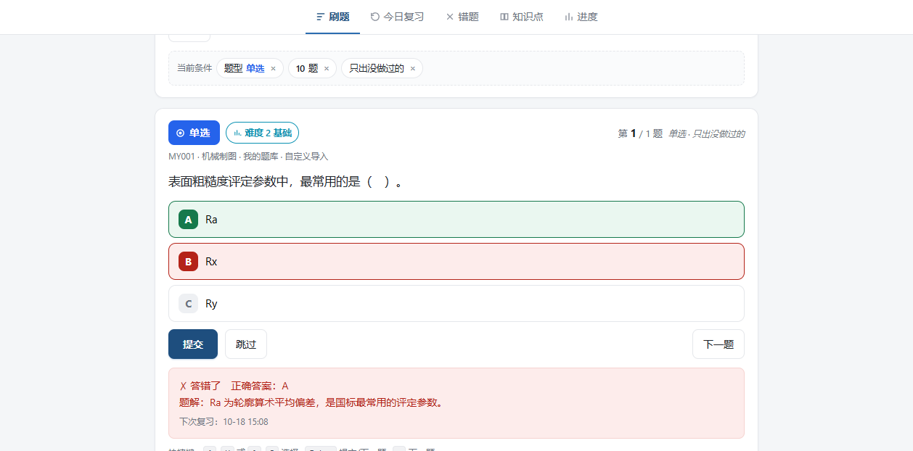
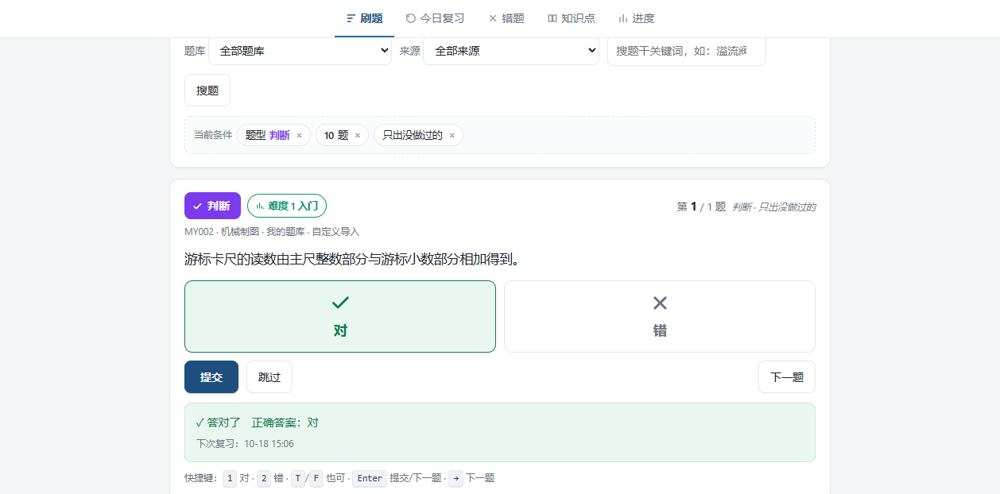
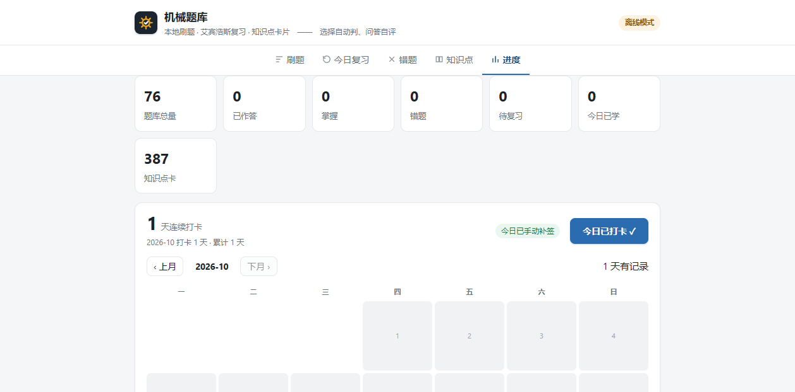
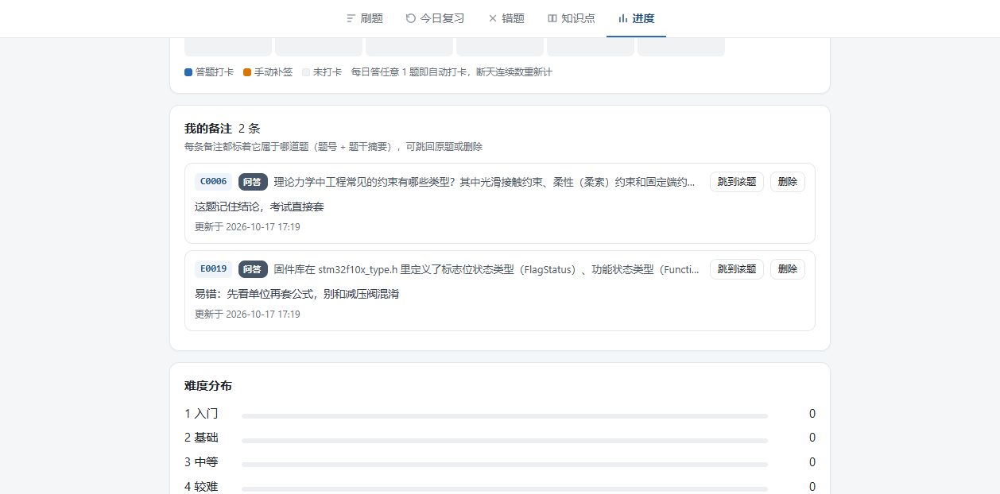

# mech-qbank · 机械题库

本地优先的**机械 / 非标自动化刷题工具**：题库浏览、随机刷题、艾宾浩斯复习、错题本、知识点卡片、学习打卡。

[](https://www.python.org/)
[](#数据来源与许可重要)

| 选择题：ABCD 按钮 | 判断题：✅❌ 按钮 | 学习打卡 | 题目备注 |
|---|---|---|---|
|  |  |  |  |

- **零第三方依赖**：服务端只用 Python 标准库（`http.server` + `sqlite3`），前端是原生 HTML/JS/CSS
- **一套 UI 两个壳**：Windows 双击 `start.bat` 即用（在线模式）；同一份 `web/` 也能塞进 Android WebView 壳出 APK（file:// 静态模式：数据内联成 `qbank-data.js`，进度存 localStorage，飞行模式可用）
- **不做 LLM 批改**：选择题/判断题本地自动判分，问答类给出参考答案由你自评（无 key、无联网、无隐私外泄）
- **数据与代码分离**：题库淬成一个 `qbank.sqlite`，App 只读它

## 快速开始

```bash
# 1) 构建数据库（可选：仓库自带 data/public/qbank.json 示例数据，跳过也能直接跑）
#    源题库目录用环境变量 QBANK_SRC 指定（或放进 ./源材料/）
export QBANK_SRC=/path/to/your/qbank      # Windows: set QBANK_SRC=D:\your\qbank
python tools/qbank_build.py

# 2) 冒烟测试（不依赖浏览器；全量模式用临时副本，不碰真实数据）
python tools/smoke_test.py            # 服务端全量模式
python tools/smoke_test.py --public   # 服务端公开子集模式
node tools/smoke_static.js            # APK 静态模式（纯前端 Store，需 Node）

# 3) 启动
python app/server.py        # 或 Windows 双击 start.bat
# → http://127.0.0.1:8640
```

要求 Python 3.10+，无 pip 依赖。环境变量：`QBANK_SRC` 源题库目录、`QBANK_PORT` 改端口（被占用时自动顺延，`QBANK_PORT_SCAN` 控制尝试个数）、`QBANK_NO_BROWSER=1` 关自动开浏览器、`QBANK_INTERVALS` 自定义复习间隔（默认 `1,3,7,15,30,60`）。

## 功能

| 页面 | 内容 |
|---|---|
| 刷题 | 按难度（L1–L5 入门→困难，下拉带文字档位与题数）/ 题型（下拉按题库真实分布生成）/ 题库 / 章节来源筛选，随机组卷，只出没做过的；支持题干关键词搜题；多选可多选后按组合判分。题卡头固定标注当前题的题型徽章与难度徽章，组卷条件条实时预览、可点 × 单项清除；每题可写**自己的备注**（唯一绑定该题号，标「有备注」） |
| 今日复习 | 按艾宾浩斯间隔（1/3/7/15/30/60 天）推送到期题；答错次日必回 |
| 错题 | 累计错次排序，一键「重练本页错题」 |
| 知识点 | 卡片式知识点（一卡 = 一个结论 + 关键数字/公式 + 关联题号），支持搜索 |
| 进度 | 题库总量 / 已答 / 掌握 / 错题 / 待复习 / 今日已学 / 难度分布 / 题型分布；**学习打卡**（连续天数 + 月历，答题自动打卡、可手动补签）；**我的备注**（全量列表，每条标着题号 + 题干 + 题型，可跳回原题或删除）；进度导出导入（JSON）；**题库导入**（仅 APK 静态模式） |

- 判分本地完成：选择/判断自动判（多选需全选对）；问答/计算给出参考答案自评；「答案待补」会明示
- 作答按钮化：选择题为 ABCD 字母徽章按钮（提交后正确项恒标绿、选错标红）；无选项判断题为 ✅/❌ 两个大按钮，键盘 `1`/`T` = 对、`2`/`F` = 错
- 键盘快捷键：`A`–`H` 或 `1`–`8` 选择、`Enter` 提交/下一题、`→` 下一题
- 每组做完出会话小结（对/错/自评/跳过/正确率）
- **APK 导入自己的题库**：进度页粘贴/选择 JSON（`{"questions":[...]}`），支持示例模板一键填入；重复题号可跳过或覆盖，撞内置题号会被拒绝并逐条列出原因；导入题与内置题同权参与筛选、判分与复习，存 localStorage，可随时清空
- **学习打卡**：答过题的日子自动打卡（从学习记录按日聚合，无需额外操作），也可在进度页手动补签；打卡卡显示连续打卡天数、今日状态与当月日历（周一起始，答题日钢蓝 / 补签日琥珀 / 今日描边），可翻看历史月份；断天后再打卡自动续上连续天数
- **题目备注**：每道题下方「＋ 给这道题添加备注」，备注唯一绑定该题号（题卡标「有备注」，备注框标题写「我的备注 · 题号」）；进度页「我的备注」汇总所有备注，每条都带**题号 + 题型 + 题干摘要**，可一键「跳到该题」或删除。静态模式存 localStorage，在线模式存 `data/notes.json`（与题库分离，重建题库不丢）

## 数据来源与许可（重要）

- **代码**：MIT（见 `LICENSE`）
- **内容**（题库文本、知识点卡片）：CC-BY-SA-4.0（见 `LICENSE-CONTENT`）
- 本仓库**只收录作者自出的题目与通用机械知识点**。任何**公司真题、培训机构套卷、第三方网站面经**均不在收录范围内，构建脚本会按来源分级自动拦截（见 `tools/qbank_build.py` 的 `classify()` 与 `clean()`）。

## 目录结构

```
mech-qbank/
├ app/server.py            服务端（标准库，零依赖）
├ web/index.html           单页 UI（原生 JS；file:// 下自动切静态模式）
├ web/qbank-static.js      静态模式纯前端 Store（判分/间隔逻辑与服务端同源）
├ web/qbank-data.js        静态模式内置数据（tools/make_webdata.py 生成，勿手改）
├ tools/qbank_build.py     数据构建器：md/json → qbank.sqlite + 公开子集 + 构建报告
├ tools/make_webdata.py    公开子集 → qbank-data.js（写前重跑三道闸）
├ tools/smoke_test.py      冒烟测试：服务端全链路（全量/公开两种模式）
├ tools/smoke_static.js    冒烟测试：静态模式 Store（Node 运行）
├ data/
│ ├ qbank.sqlite         全量库（本地生成，不入库）
│ └ public/qbank.json    公开子集（示例数据，入库）
├ docs/                    界面截图（README 展示用）
├ start.bat                Windows 启动器（纯 ASCII）
└ BUILD_REPORT.md          构建报告（本地生成，不入库）
```

> 构建器与 `make_webdata.py` 共用同一套「来源分级 + 污染检测」规则；与具体公司相关的来源标记不写在开源代码里，需要时放在 `data/private/taint-extra.txt`（每行一个词，已被 `.gitignore` 排除）。

## 数据模型（`data/public/qbank.json`）

```jsonc
{
  "schema": 1,
  "license": "CC-BY-SA-4.0 (content) / MIT (code)",
  "questions": [{
    "id": "P0001",              // 题号：Q#### 主库 / P|E|C|M|G#### 学习库
    "bank": "学习库/Python",
    "section_path": "Python · 题库 › 基础语法",  // 章节来源路径，供 App 按来源筛选
    "cat_name": "基础语法",
    "stem": "题干……",
    "qtype": "单选|多选|判断|问答|计算|识记",
    "level": 1,                 // 1–5 难度
    "options": ["A. ……", "B. ……"],
    "answer": "B",              // 判断题为「对/错」；问答类为要点文本
    "explanation": "题解 / 依据",
    "source_class": "自出"
  }],
  "cards": [{
    "chapter": "2 传动与标准件", "topic": "2.3 滚动轴承",
    "name": "轴承配合基准制", "body": "……", "qids": ["Q1201"]
  }]
}
```

## 怎么加题（欢迎 PR）

1. 直接编辑 `data/public/qbank.json`（或你自己的 md 源库后重跑构建器）
2. 题号唯一、`level` ∈ 1–5、`qtype` 用上表的取值
3. 判断题 `answer` 写 `对` / `错`；选择题写字母（多选如 `AB`）；问答题写要点
4. 只提交**你自己写的**题，不要粘贴公司笔试卷或网站面经 —— 这类内容会被 CI/维护者直接拒收

## 手机 APK（静态离线模式）

`web/` 是同一份 UI：检测到 `file://` 协议时自动切静态模式 —— 数据由 `tools/make_webdata.py` 从公开子集生成 `qbank-data.js`（`window.QBANK_DATA`）经 `<script>` 标签内联加载（file:// 页面不能 fetch 本地 JSON，会被 CORS 拦），判分与复习间隔逻辑在 `web/qbank-static.js` 中与服务端同源实现，进度存 localStorage。把 `web/` 下三个文件（`index.html`、`qbank-data.js`、`qbank-static.js`）放进任意 WebView 壳的 assets 目录即可离线刷题；改公开题库后重跑 `make_webdata.py` 再拷贝即可。

APK 额外能力：**导入自己的题库**（JSON，见「功能」表最后一条）—— 公开子集以问答/计算题为主，选择题靠用户导入补充；导入题与内置题同权。参考实现为一个克隆自通用 WebView 壳的 Android 工程（applicationId `com.xinghui.mechqbank`，minSdk 26 / targetSdk 34），图标为齿轮+对勾矢量图（`drawable/ic_launcher_foreground.xml`）。

## 打包 Windows exe（免装 Python）

```bash
build_exe.bat          # 或手动：
pyinstaller --noconfirm --onefile --name mech-qbank ^
  --add-data "web;web" --add-data "data/public;data/public" ^
  --exclude-module tkinter app/server.py
```

产物 `dist\mech-qbank.exe`（约 9.7 MB，实测）：

- **双击即用**：自带公开题库（76 题 + 387 知识点卡），自动开浏览器，进度写在 exe 同级的 `data\progress.json`
- **想用你自己的全量库**：把 `qbank.sqlite` 放进 exe 同级的 `data\` 目录即可，程序自动切换成全量模式（实测：2330 题）
- 端口默认 8640，可用环境变量 `QBANK_PORT` 改；`QBANK_NO_BROWSER=1` 可关掉自动开浏览器

## 已知边界

- 问答题/计算题**不做自动判分**（有意为之：本地、离线、无 key），由使用者自评
- 多选题需**全选对**才计正确（漏选/多选均计错，进错题本）
- 部分题目标注「答案待补」，界面会明示；此类题无法自动判分
- 知识点卡片由题目归纳而来，数值以图纸/标准/厂商样本为准

## 路线图

- [x] PyInstaller 打包 Windows exe（双击即用，免装 Python）
- [x] 导入/导出学习进度（JSON），多设备手动同步
- [x] 间隔重复算法可配置（`QBANK_INTERVALS`，默认 1/3/7/15/30/60 天）
- [x] 冒烟测试（`tools/smoke_test.py`，数据层 + HTTP 全链路）
- [x] Android WebView 壳出 APK（file:// 静态模式：`qbank-data.js` 内联公开子集 + localStorage 进度，飞行模式可用；`tools/make_webdata.py` 重新生成数据）
- [x] APK 导入自定义题库（JSON 导入 + 模板 + 去重/覆盖 + 拒绝撞内置题号）
- [x] UI 重设计：题型/难度徽章、条件 chips 预览、动态题型下拉、齿轮品牌图标
- [x] 学习打卡：答题自动打卡 + 手动补签 + 连续天数 + 月历记录（静态模式存 localStorage，在线模式存 `data/checkin.json`）
